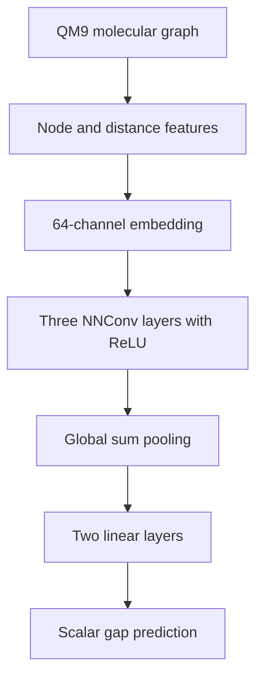

# Molecular Property Prediction with Graph Neural Networks

## Overview and problem statement

Graph-level regression of the HOMO–LUMO energy gap of small molecules using QM9 and a custom PyTorch Geometric neural network. The experiment explores a data-driven approximation to computational chemistry calculations; it is not a validated substitute for quantum-chemical simulation.

## Technology stack and prerequisites

| Dependency | Declared version |
| --- | --- |
| PyTorch | 2.7.0+cpu |
| torchvision | 0.22.0+cpu |
| torchaudio | 2.7.0+cpu |
| torch_geometric | 2.6.1 |
| rdkit-pypi | 2022.9.5 |
| NumPy | 1.26.4 |

These are exact pins from [requirements.txt](requirements.txt), not a tested cross-platform compatibility matrix. Python 3 is required; an exact version is not specified. A CPU is sufficient for the declared build; CUDA is optional in the source but requires a compatible CUDA-enabled PyTorch installation. Allow disk space and network access for QM9.

## Project structure

- [train_gnn_qm9.py](train_gnn_qm9.py) — training and evaluation.
- [gnn_qm9_homo_lumo.pt](gnn_qm9_homo_lumo.pt) — committed model artifact; its compatibility and provenance were not independently tested.
- [research_notes.md](research_notes.md), [project_explanation.md](project_explanation.md), [code_explanation.md](code_explanation.md) — design and implementation notes.
- [requirements.txt](requirements.txt) — dependency pins.
- [LICENSE](LICENSE) — repository license.

## Dataset

The script loads [QM9 via PyTorch Geometric](https://pytorch-geometric.readthedocs.io/en/2.6.1/generated/torch_geometric.datasets.QM9.html), downloading to `data/QM9` relative to the working directory if necessary. Dataset licensing is separate from repository licensing; consult the upstream dataset documentation.

The target is property index 4 (HOMO–LUMO gap). Each node receives five atom-type indicators (H, C, N, O, F) and three normalized position features. Each edge receives interatomic distance and three Gaussian distance-basis features. A seeded permutation (42) allocates 110,000 training graphs, 10,000 validation graphs and the remainder to test.

## Model architecture and training



The implemented model is NNConv-based, not SchNet. Adam uses learning rate 0.001, MAE loss, 30 epochs, batch size 128 and four data-loader workers. ReduceLROnPlateau reduces learning rate by 0.5 after five epochs without improvement, down to 0.000001. Best validation MAE selects the checkpoint.

## Installation and execution

```bash
git clone https://github.com/Rmadanmohamed/molecular-property-prediction-gnn.git
cd molecular-property-prediction-gnn
python -m venv .venv
source .venv/bin/activate
python -m pip install -r requirements.txt --extra-index-url https://download.pytorch.org/whl/cpu
```

On Windows, use `.venv\Scripts\Activate.ps1` instead of the activation command. The original code saves to the Linux-specific absolute path `/home/ubuntu/gnn_qm9_homo_lumo.pt`. Before execution, ensure that destination exists and is writable, or configure a suitable path in a **local working copy**; this repository's source is unchanged. The transform is defined inside `main`, which may be incompatible with multiprocessing spawn on Windows/macOS. A local worker-count adjustment may be necessary.

```bash
python train_gnn_qm9.py
```

## Environment variables and configuration

No application environment variables are required. Dataset path, checkpoint path, device selection and training hyperparameters are constants in the script. The committed CPU builds and older RDKit pin may need a compatible interpreter/platform; setup has not been executed during this audit.

## Usage and evaluation

The script prints batch dimensions, training MAE, validation MAE and elapsed time per epoch. It saves the best model state dictionary, reloads it and prints final test MAE. No verified numeric test result was identified in the inspected source or accompanying Markdown notes. The checkpoint is not an independently validated inference service.

## Testing and validation

No automated test suite is included. The script's held-out evaluation is the model validation mechanism. Training, checkpoint loading and tests were not executed in this documentation audit.

## Screenshots and live demo

No verified live deployment or standalone evaluation plot is included. See the linked design notes for further explanation.

## Limitations

The architecture does not explicitly ensure rotational invariance for normalized Cartesian coordinates. Evaluation is limited to the QM9 split and does not establish generalization to larger molecules. Checkpoint compatibility, reproducible setup and external validation remain outstanding. Add a dataset license reference, reproducible environment and model card.

## Author

**Ramadan Mohamed Hassan** — AI Engineer | AI Researcher | AI Automation | LLM & RAG Systems | Machine Learning

[Portfolio](https://ramadan-ai-portfolio.vercel.app/) · [LinkedIn](https://www.linkedin.com/in/ramadan-mohamed-89085a366/) · [GitHub](https://github.com/Rmadanmohamed) · [Email](mailto:ramadanmohameddd3@gmail.com)
